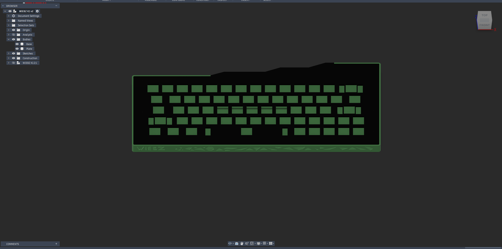

# October 14th, 2026: redesigned everything to make it more sleek
So based off a freinds recommendation i had to redesign the whole keyboard by flipping the mcu and making it bottom mount..it was because of that MCU cover being too bulky and ruining the looks...so i first started with the pcb by flipping the mcu and rerouting the pcb then i went to the case and removed that big brick from the top and made it flat...i also added supports for the pcb on the base...that should be all...i think
https://lapse.hackclub.com/timelapse/RB5Q_xvCT_o_

**Total time spent: 3h 43m**

# 13th November, 2026: Soldered the first row of LEDs
The PCB finally aarrived today (clean AF), the components arrived the day before...so i first sized everthing and after that i soldered a diode, led and socket for one switch and then i soldered all the sk6812 mini e leds on the first row, took a lot of time as its my first time soldering smd parts and at that a small smd part....but im getting the hang of it...and ill prolly regret not recording this session on laspe but oh well

**Total time spent: ~1h 30m**
